As finanças de uma família em dois países e duas moedas rodam em uma única planilha, e cada número nela é auditado.

É um sistema local-first que transforma extratos de banco e de cartão de 16 contas em uma visão consolidada de fluxo de caixa, em CAD e BRL. Código determinístico faz todos os cálculos; um LLM local só sugere categorias, e um humano confirma.

*Todas as telas desta página usam valores fictícios, apenas para demonstração do sistema.*

## O que ele faz

- Lê 20 fontes de extrato (CSV, OFX e PDF digital) com 13 parsers determinísticos
- Converte BRL, USD e EUR para CAD pela cotação do Bank of Canada no dia de cada transação
- Pareia pagamentos de cartão, transferências internas e remessas internacionais, para nada ser contado duas vezes
- Categoriza por regras; para o resto, três LLMs locais no Ollama votam, e só uma resposta unânime vira sugestão
- Reconstrói os dashboards no Google Sheets a cada execução: fluxo de caixa anual, por pessoa, dívidas (principal x juros), investimentos contra a alocação-alvo, e gráficos
- Audita cada execução com 4.302 conferências independentes

## Como funciona

Um único comando roda o pipeline inteiro. O LLM participa de exatamente uma etapa, e nunca toca nos números.

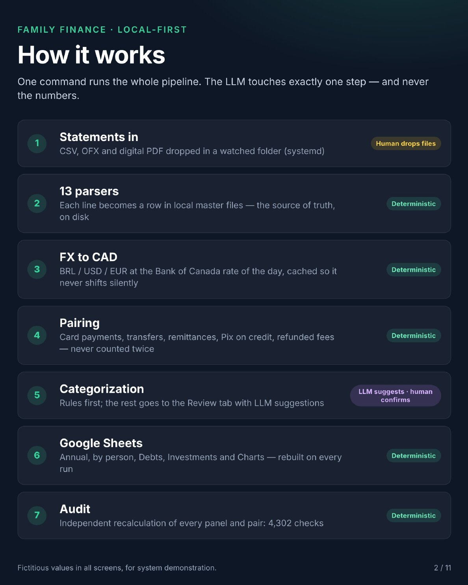

## A planilha

**Transações.** Uma linha por lançamento de extrato. BRL convertido para CAD pela cotação do dia; transferências e pagamentos de cartão pareados para nada contar duas vezes.

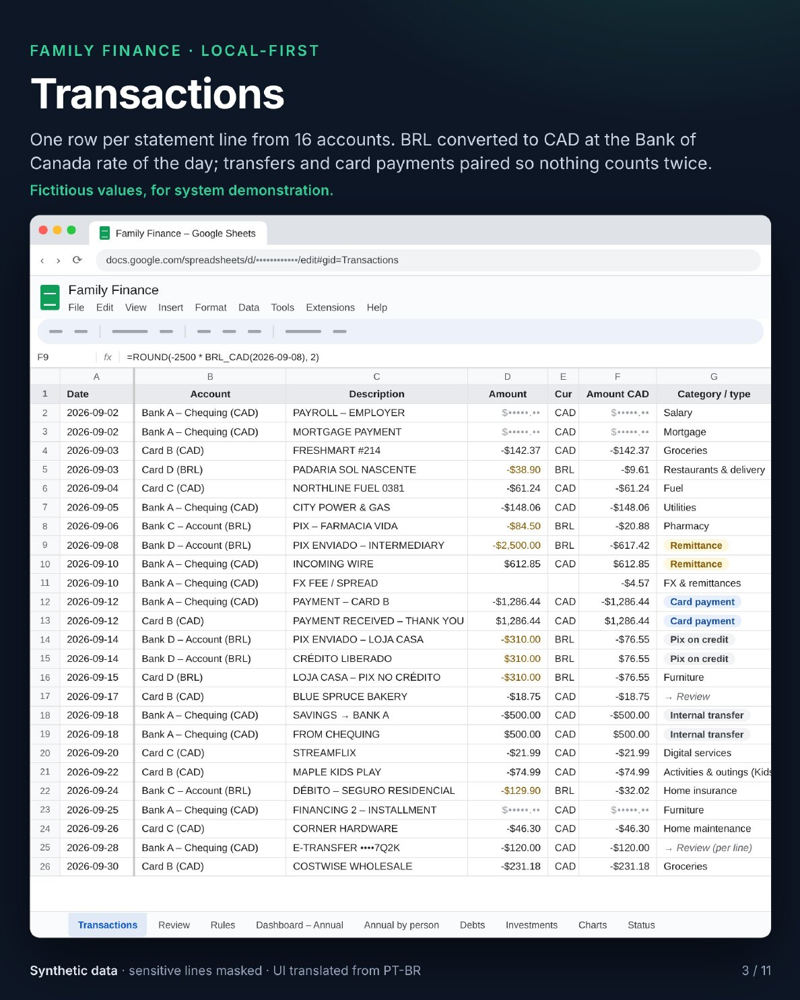

**Painel anual.** O que entra, o que sai e o que sobra, consolidado em CAD.

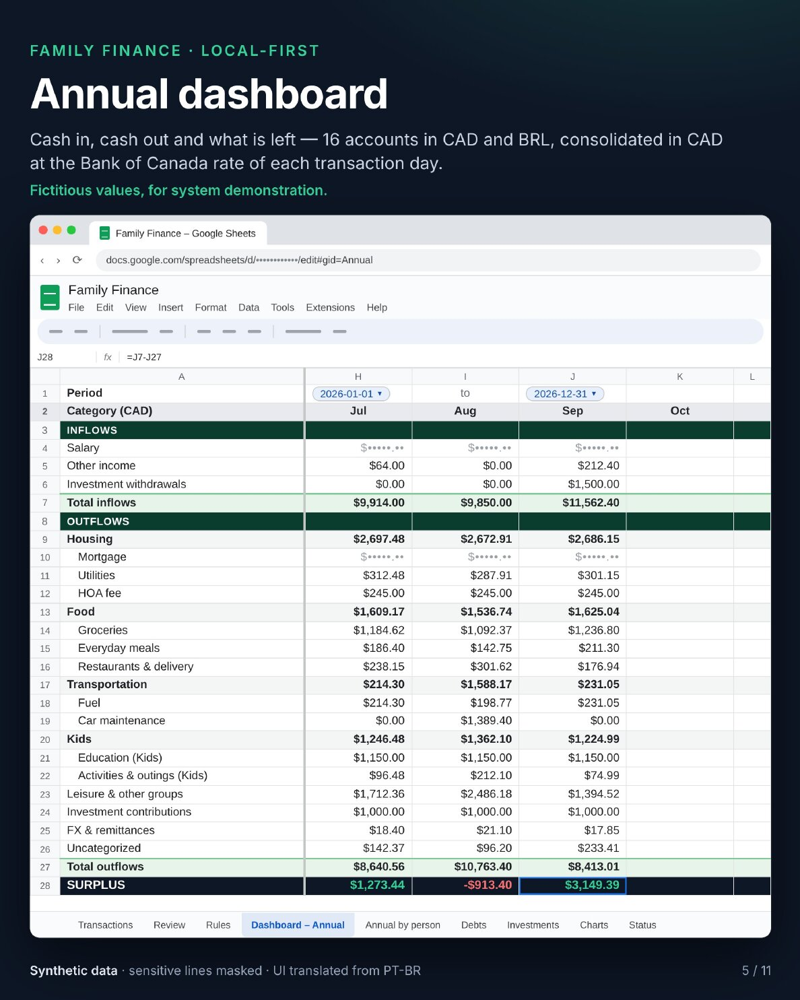

**Anual por pessoa.** Cada despesa pertence ao titular da conta de onde saiu, para perceber cedo se uma pessoa está ficando no negativo.

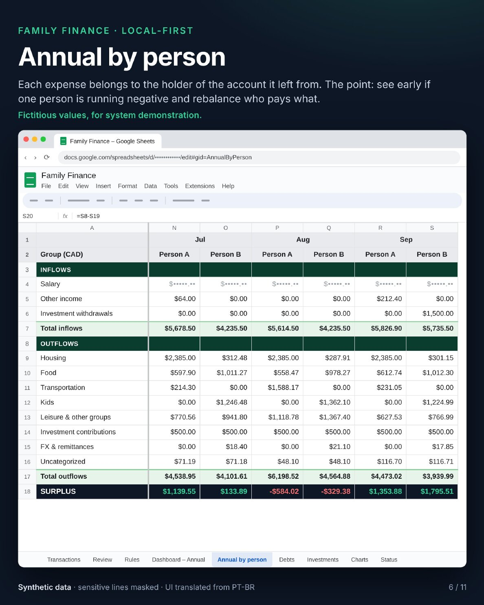

**Dívidas.** Cada dívida separada em principal e juros, e quanto da renda elas consomem por mês.

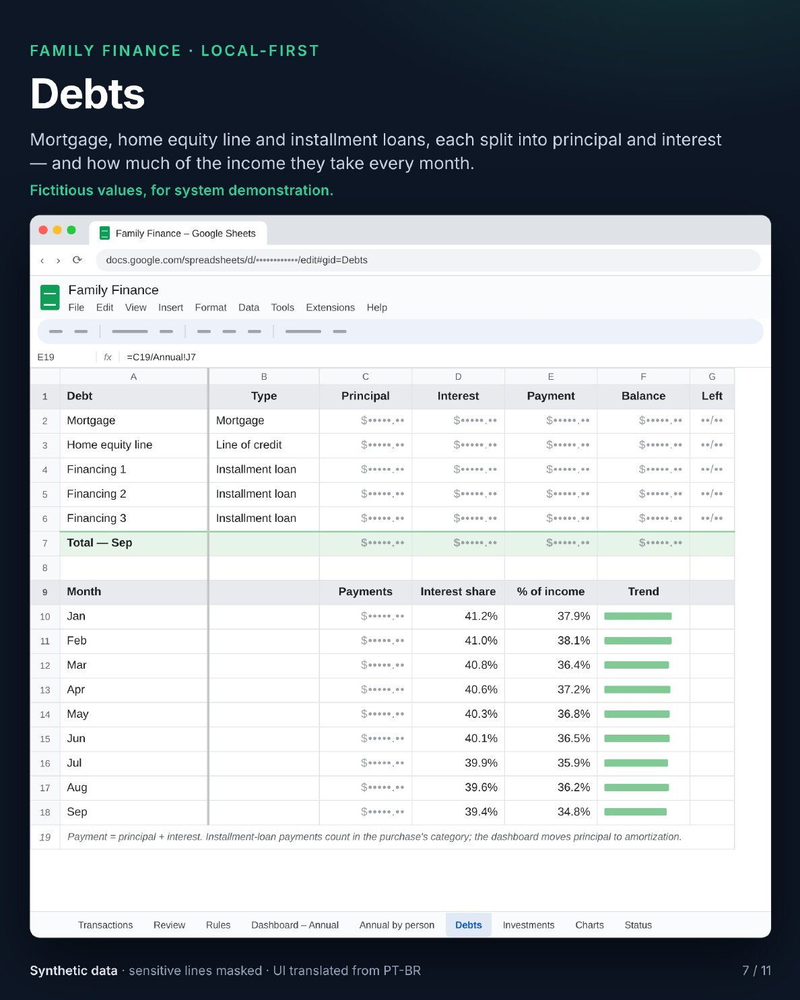

**Investimentos.** Agrupados por classe, tipo e ativo, com um percentual-alvo para cada um e quanto falta ou sobra.

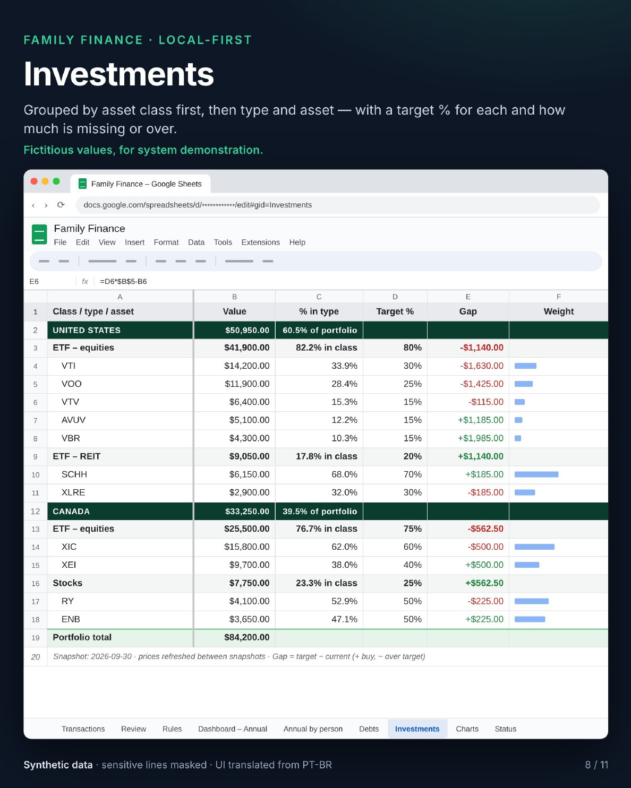

**Gráficos.** Gráficos nativos do Google Sheets alimentados pelos painéis, cada um seguindo o seletor de período do próprio painel.

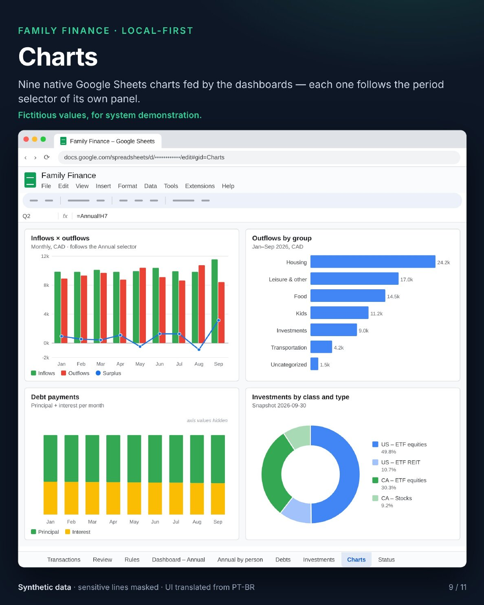

## LLMs locais sugerem. O código decide.

Todo valor, soma, conversão de moeda e pareamento é feito por Python determinístico. Os modelos participam de uma única etapa: propor uma categoria para comerciantes que as regras ainda não cobrem.

- Três modelos locais no Ollama (gemma4:12b, gemma4:26b e gpt-oss:20b) respondem à mesma fila
- Só uma resposta unânime vira sugestão; votos divididos aparecem com a resposta de cada modelo
- A saída é estruturada e restrita a uma lista fechada de 67 categorias, com temperatura 0
- Categorias que dependem de intenção (presentes, passeios das crianças, tipo de seguro) são bloqueadas pelo código antes da votação
- O prompt leva o nome do comerciante, o tipo de conta e regras parecidas, nunca um valor
- Uma sugestão só vira regra quando um humano marca Confirmar na aba de revisão

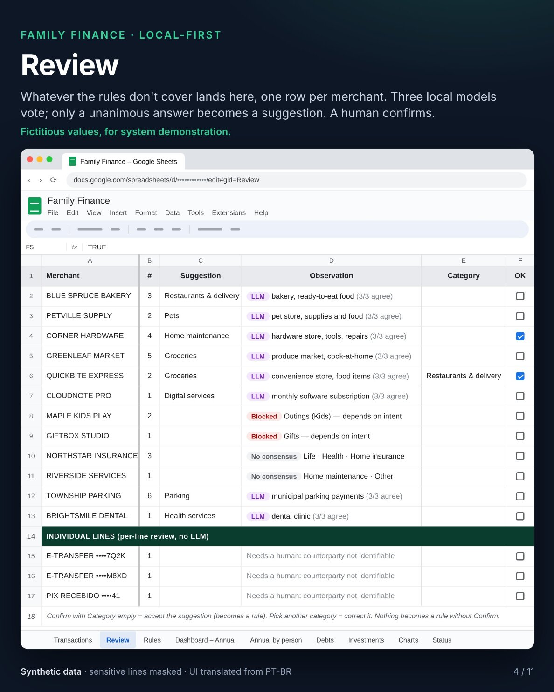

**Como a configuração foi escolhida.** Sete configurações de modelos foram medidas em um teste leave-one-out contra 114 regras de categorização escritas por um humano. Modelos sozinhos ficaram entre 75% e 86% de precisão. O voto unânime de três modelos de duas famílias, somado à lista de bloqueio, chegou a 97,6% de precisão com 73% de cobertura; o restante vira "não sei" em vez de uma resposta errada. O modo de raciocínio não melhorou a precisão nessa tarefa, e mais exemplos no prompt pioraram o resultado. A precisão do teste é um teto, já que a lista de bloqueio foi escolhida com os mesmos dados; a taxa real de aceitação é acompanhada a cada confirmação.

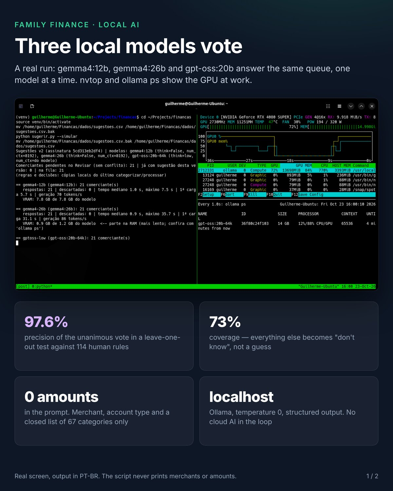

## Toda execução termina com uma auditoria

Um painel que parece certo não é o mesmo que um painel certo. Depois que os painéis são reconstruídos, um script somente leitura recalcula tudo a partir dos arquivos mestres locais e compara com a planilha, com tolerância de um centavo: 4.302 conferências, e todas precisam bater.

- **A.** Cada transação da planilha contra o arquivo mestre local
- **B.** Cada célula dos painéis, recalculada em Python
- **C.** Os totais anuais de novo, por um cálculo independente com regras próprias
- **D.** A identidade do dinheiro: a sobra do mês é igual à soma de todas as contas, e os dois lados de cada transferência se anulam
- **E.** Cobertura: nenhum extrato ou mês faltando em nenhuma conta
- **F.** Investimentos e dados dos gráficos contra suas fontes
- **G.** Uma conferência humana: o último saldo de cada conta e lançamentos sorteados para comparar com os extratos

A auditoria não grava nada e não corrige nada: ela informa qual camada falhou e por quanto. A primeira execução completa encontrou uma divergência real, uma transferência interna em BRL que saiu num dia e chegou três dias depois, com outra cotação. A correção foi para a regra, não para uma lista de exceções. A auditoria tem seus próprios testes: 29 casos e 38 bugs injetados de propósito, todos detectados.

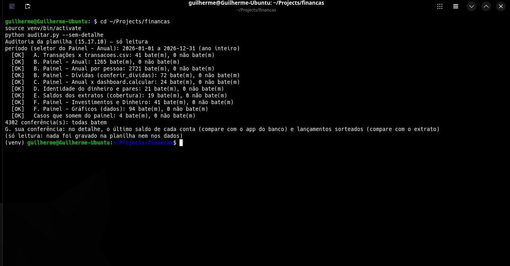

## Em números

Construído com o Claude Code como parceiro de engenharia.

- ~25.600 linhas de Python, mais da metade em testes e scripts de mutação
- 718 casos de teste; 204 bugs injetados de propósito, todos detectados
- 75 commits em 16 dias
- 41 horas de atividade de commits (só o tempo entre commits)
- ~60 horas de sessões no Claude Code e ~4M tokens de contexto (ambos estimados)

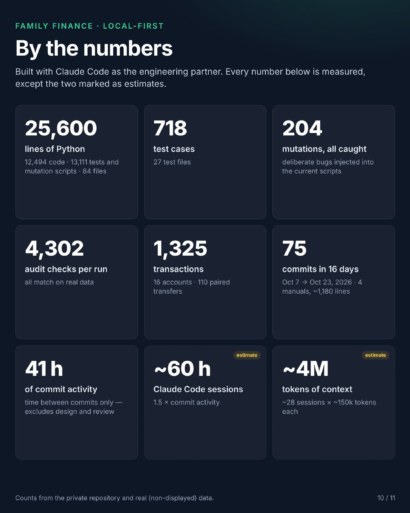

## O que ele não faz

- Conectar aos bancos ou guardar credenciais bancárias; os extratos são baixados e colocados numa pasta monitorada
- Deixar um LLM ler valores, fazer contas ou criar regras
- Enviar dados financeiros para qualquer serviço de IA na nuvem
- Movimentar dinheiro ou tomar decisões de investimento

O repositório é privado, porque guarda a configuração real de uma família. Se uma versão pública e generalizada for útil para você, fale comigo pela página de [Contato](/pt-br/contact/).

## Stack

Python · Ollama (gemma4, gpt-oss) · Google Sheets API · systemd · cotações do Bank of Canada · Claude Code · Git
